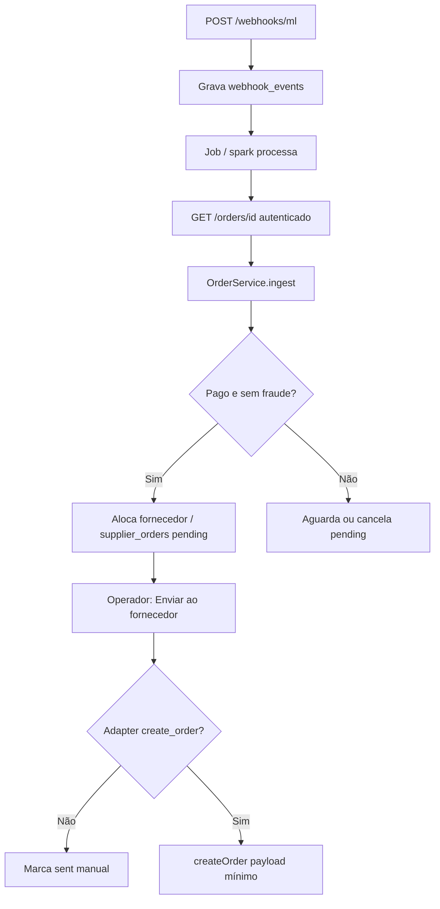
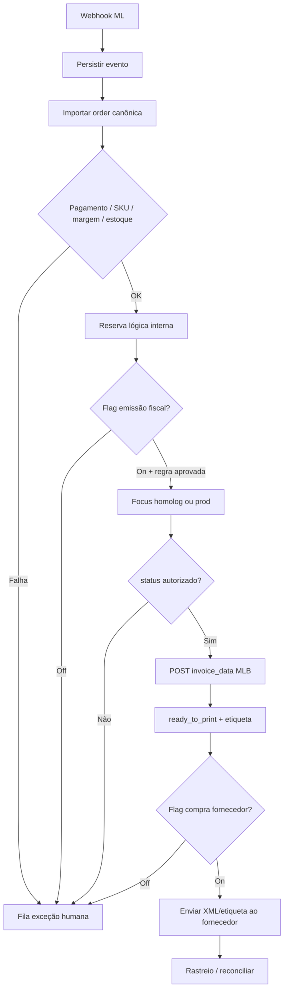

# Fase 0 — Auditoria: dropshipping nacional e NF-e (Vitrine Hub)

**Status:** aguardando aprovação humana  
**Escopo desta entrega:** somente leitura do repositório e proposta. Nenhuma migration aplicada, nenhuma emissão fiscal, nenhum pedido a fornecedor, nenhuma publicação de anúncio.  
**Repositório auditado:** `marketplace-hub` (marca Vitrine Hub), branch `main` (HEAD recente: site institucional + webhook `/webhooks/ml`).  
**Data da auditoria:** 2026-11-13.

---

## 1. Veredito

O sistema **já cobre** catálogo, fornecedores (manual/CSV), seleção, precificação, OAuth Mercado Livre (PKCE), anúncios, webhooks/pedidos, fila de jobs e deploy por GitHub Actions. **Não existe** módulo fiscal, importação de XML no shipment, emissão de etiqueta, armazenamento de credenciais de fornecedor/emissor, nem adapters reais DSlite/Dropify (`Config\SupplierConnectors::$adapters` está vazio).

O caminho seguro é **estender** a arquitetura pluggable já existente (`SupplierConnectorInterface`, `MarketplaceAdapter`, `JobQueue`, `OrderService`), com feature flags desligadas por padrão e PRs pequenos — sem reescrever OAuth, landing, deploy ou banco de produção de forma destrutiva.

**Bloqueadores externos (não resolvíveis só com código):**

1. Contador validar matriz fiscal (CFOP/CSOSN/CRT/natureza; venda à ordem vs remessa).
2. Situação cadastral RN (CNPJ, IE, SEFAZ, certificado A1) e alinhamento do cadastro ML.
3. Credenciais e contrato operacional do piloto de fornecedor (DSlite Dropshipping PJ e/ou Dropify START).
4. Conta Focus NFe (ou outro emissor) em homologação, separada de produção.
5. Confirmação de que a conta ML **não** usa integração nativa do fornecedor no mesmo anúncio/estoque.

---

## 2. O que já existe (inventário real)

### 2.1 Stack e deploy

| Item | Situação |
|------|----------|
| CodeIgniter 4 / PHP / MySQL | Em uso (`composer.json`, Docker Compose, Spark) |
| Deploy | `.github/workflows/deploy.yml` → SSH no VPS (push em `main` + `workflow_dispatch`); chave só executa o script remoto |
| Ambiente | `.env` local (não versionado); `.env.example` só com nomes |
| Landing pública | Rotas `/`, `trocas-e-devolucoes`, `privacidade` (`StoreController`) — preservar |
| Papéis | `admin` / operador; filtros `auth`, `role`, throttles |

### 2.2 Tabelas (migrations 000001–000019)

`users`, `settings`, `audit_logs`, `sync_logs`, `categories`, `suppliers`, `products`, `product_images`, `supplier_offers`, `supplier_imports`, campos de seleção/preço, `marketplaces`, `marketplace_accounts` (tokens cifrados), `marketplace_listings` (+ events, category mappings, automação de preço), `webhook_events`, `orders`, `order_items`, `supplier_orders`, `jobs`, `scheduled_tasks`.

**Ausentes (Fase 1+):** credenciais de integração, documentos fiscais, shipments detalhados, regras fiscais por UF, jobs/eventos específicos de NF-e/fornecedor API, NCM/CEST/origem fiscal em produto.

### 2.3 Serviços e padrões a reutilizar

- **Fornecedores:** `SupplierConnectorInterface` + `AbstractSupplierConnector` + `SupplierConnectorFactory` + `Config\SupplierConnectors` (registro por ID).
- **Implementações atuais:** `ManualSupplierConnector`, `CsvSupplierConnector` apenas.
- **Pedidos:** `OrderService` — ingest idempotente (`marketplace_account_id` + `external_order_id`), alocação ao pagar, `sendToSupplier` **só com ação humana**, locks `FOR UPDATE`.
- **ML:** `MercadoLivreAuthService` (PKCE, refresh com trava), `MercadoLivreNotificationService` (grava e processa depois), `MercadoLivreOrderService` (`GET /orders/{id}`), `MercadoLivreProductService` (publicação com prévia).
- **Automação:** `Scheduler` + `JobQueue` + cron `schedule:run` && `jobs:work`; flags de auto estoque/preço **desligadas por padrão**.
- **Segurança:** `TokenCipher` / `encryption.key`; `AuditService` mascara chaves sensíveis; tokens ML nunca em log/API/tela completa.

### 2.4 Fluxo atual de pedidos (já implementado)

**Lacunas neste fluxo para dropshipping + NF-e:** não há consulta de shipment (`invoice_pending`), emissão/armazenamento de NF-e, `POST .../invoice_data`, download de etiqueta, nem envio de XML/etiqueta ao fornecedor. `connectorPayload()` hoje só manda `reference`, `external_order_id`, `shipping_id` e itens (sku/qtd/custo) — insuficiente para DSlite (XML) e Dropify (`consumer`, `salePrice`, etc.).

### 2.5 Variáveis de ambiente (somente nomes)

Já previstas em `.env.example` / configs:

`CI_ENVIRONMENT`, `app.baseURL`, `app.forceGlobalSecureRequests`, `MYSQL_*`, `database.default.*`, `database.tests.*`, `encryption.key`, `SEED_ADMIN_*`, `SEED_OPERATOR_*`, `MELI_CLIENT_ID`, `MELI_CLIENT_SECRET`, `MELI_REDIRECT_URI`, `MELI_USE_PKCE`, `MELI_LOGISTIC_TYPE`, `MELI_SHIPPING_MODE`, `MELI_WEBHOOK_IPS`, opcionais `mercadolivre.authUrl` / `mercadolivre.siteId`, `logger.threshold`.

**Ainda não existem no exemplo (não inventar valores no chat):** nomes sugeridos para fases seguintes, a criar só após aprovação — `FOCUSNFE_TOKEN`, `FOCUSNFE_ENV`, `DSLITE_TOKEN`, `DSLITE_BASE_URL`, `DROPIFY_CLIENT_ID`, `DROPIFY_CLIENT_SECRET`, `DROPIFY_FREIGHT_KEY`, `DROPIFY_WEBHOOK_TOKEN`, flags `FISCAL_AUTO_ISSUE`, `SUPPLIER_AUTO_PURCHASE`, etc.

### 2.6 Inventário de rotas HTTP

**Público**

| Método | Rota | Função |
|--------|------|--------|
| GET | `/`, `/trocas-e-devolucoes`, `/privacidade` | Site institucional |
| GET/POST | `/login`, POST `/logout` | Auth |
| POST | `/webhooks/mercadolivre`, `/webhooks/ml` | Notificações ML (throttle) |

**Painel (auth)** — grupos: `dashboard`, `suppliers`, `categories`, `products`, `orders` (+ import/sync/reallocate/send), `sync`, `pricing`, `offers`, `imports`, `marketplaces`, `marketplaces/mercadolivre/*` (contas, categorias, listings, notifications), admin: `users`, `settings`, `logs`.

**API JSON (auth):** `api/products`, `offers`, `selection`, `pricing`, `suppliers`, `marketplaces`, `accounts`, `orders`.

**A criar (proposta):** rotas de fiscal, webhooks Focus/fornecedor, painel de integrações — ver §6.

### 2.7 Comandos Spark relevantes

`schedule:run`, `jobs:work`, `suppliers:sync`, `suppliers:select`, `meli:refresh-token`, `meli:process-notifications`, `meli:import-orders`, `meli:sync-stock`, `meli:sync-prices`, `marketplace:sync`.

---

## 3. Conferência com fontes oficiais (sem operação real)

### 3.1 Mercado Livre — importar NF-e

Doc consultada: [Importar Nota Fiscal](https://developers.mercadolivre.com.br/pt_br/importar-nota-fiscal).

- PJ contribuinte: importar **XML modelo 55** em `POST /shipments/{id}/invoice_data?siteId=MLB` quando status `ready_to_ship` e substatus `invoice_pending`.
- Isso **destrava** a etiqueta (`ready_to_print`). Anexar NF ao pacote **não** substitui a importação.
- Homologação SEFAZ **não** é aceita no ML de produção.
- Erros relevantes: IE/CNPJ/UF divergentes do cadastro ML; UF do emitente ≠ origem do shipment (`different_state_nfe_shipment_origin`); chave duplicada; nota já salva.
- Notificações de `shipments` devem ser processadas (hoje o webhook aceita o tópico, mas não há orquestração fiscal).

**Não verificado nesta Fase 0 (exige conta/API autenticada e aprovação):** permissões reais do vendedor, `GET /users/{id}/shipping_preferences`, `billing_info` de um shipment real, lista de logistic types ativos. Fazer em checklist operacional separado, **somente leitura**.

### 3.2 Focus NFe

Doc: [Operações disponíveis](https://doc.focusnfe.com.br/docs/operacoes-disponiveis-na-api).

- Homologação: `https://homologacao.focusnfe.com.br/v2/`; produção: `https://api.focusnfe.com.br/v2/`.
- Emissão: `POST /nfe?ref={ref}`; consulta: `GET /nfe/{ref}`; Basic Auth (token no usuário).
- Status assíncrono típico: `processando_autorizacao` → `autorizado`; baixar XML/DANFE só após autorizado.
- Webhooks + `POST /nfe/{ref}/hook` para reenvio.

### 3.3 DSlite / Dropify

- DSlite: API pública documentada (homologação/produção); pedido de dropshipping exige **XML autorizado** do lojista; há divergência comercial vs doc sobre CFOP (5120/6120 na API vs orientação comercial 5102/6102) — **só o contador decide**; validar XML na integração antes de automatizar.
- Dropify: OAuth client_credentials e endpoints conhecidos em material interno de pesquisa; liberação de pedido na prática **manual no painel**; **não ativar** canal nativo Dropify↔ML na mesma conta usada pelo Vitrine Hub.
- Credenciais reais e contrato: **faltam** no ambiente do repositório (correto).

---

## 4. Riscos

| ID | Risco | Impacto | Mitigação |
|----|-------|---------|-----------|
| R1 | Duas fontes atualizando o mesmo anúncio (VH + integração nativa do fornecedor) | Estoque/preço errados, pedidos duplicados | Uma fonte de verdade; checklist go-live; lock em `supplier_orders` |
| R2 | UF/CEP do emitente da NF-e ≠ origem do shipment ML | Rejeição `different_state_nfe_shipment_origin` / frete | Conta/endereço ML alinhados à origem real; validar com fornecedor |
| R3 | CFOP/dados fiscais inventados ou discordantes (DSlite × contador × MEI RN) | Rejeição SEFAZ/API fornecedor | Matriz configurável; zero hardcode; aprovação contador |
| R4 | Emissão automática ou compra automática ligada cedo demais | Nota/pedido reais indesejados | Feature flags off; homologação isolada |
| R5 | `connectorPayload` incompleto + retry cego em timeout | Pedido duplicado no fornecedor | Idempotency key; conferência manual após falha de rede |
| R6 | Segredos em commit/log/chat | Vazamento / LGPD | Só `.env`/secrets; XML com acesso auditado; AuditService |
| R7 | Migration destrutiva / deploy sem rollback | Downtime ou perda de dados | Só migrations aditivas; script de rollback documentado; aprovação antes de prod |
| R8 | Impacto a outros sites no VPS | Outros projetos | Deploy restrito ao script do marketplace-hub; não alterar paths alheios |
| R9 | Limites MEI / bloqueio compras / IE RN | Impede faturar | Checklist SEFAZ RN antes do go-live |
| R10 | Processar shipment sem NF autorizada | Etiqueta indisponível / atraso | Máquina de estados: NF autorizada → import ML → label → fornecedor |

---

## 5. Modelo de dados proposto (aditivo)

Não aplicar até aprovação da Fase 1. Preferir **novas tabelas** e colunas nullable; índices únicos e chaves de idempotência.

### 5.1 Extensões em tabelas existentes

- `products`: `ncm`, `cest`, `fiscal_origin` (origem mercadoria), `gtin` (se distinto de `ean`), flags `fiscal_data_status` (`pending`/`approved`).
- `suppliers`: `origin_uf`, `origin_city`, `origin_postal_code`, `provider_code` (`dslite`/`dropify`/`manual`/`csv`), `auto_purchase_enabled` (default 0).
- `orders` / fulfillment: estados intermediários fiscais/logísticos (ex.: `awaiting_invoice`, `invoice_pending_ml`, `label_ready`, `awaiting_supplier_dispatch`) — evoluir `fulfillment_status` com cuidado e migração de labels na UI.
- `supplier_orders`: `idempotency_key`, `label_sent_at`, `fiscal_document_id` (FK), `last_error`, `provider_status`.

### 5.2 Novas tabelas (proposta)

| Tabela | Papel |
|--------|--------|
| `supplier_integrations` | Credenciais cifradas por fornecedor (token/client), ambiente, last_sync, capabilities JSON, sem exibir segredo |
| `supplier_catalog_items` | Espelho do catálogo remoto (opcional se `supplier_offers` bastar no piloto) |
| `sku_mappings` | SKU fornecedor ↔ product_id ↔ external_item_id ML; unique composto |
| `logistic_origins` | Origem (UF/CEP) por fornecedor/conta ML |
| `order_shipments` | `shipping_id`, status/substatus ML, logistic_type, invoice_import_status |
| `fiscal_documents` | tipo (`sale`/`remessa`/`fornecedor`), emissor, ambiente, número, série, chave, ref, situação, protocolo, paths XML protegidos, order_id, unique(platform, order_id, doc_type) |
| `fiscal_rules` | Matriz por UF origem/destino, produto/categoria, modalidade; **valores preenchidos só após contador** |
| `integration_jobs` | Se precisar de metadados além de `jobs` (ou reutilizar `jobs` + novos types) |
| `integration_events` | Webhooks Focus/fornecedor brutos (padrão `webhook_events`) |
| `order_cost_ledger` | Custos reconciliados (produto, frete, taxa, imposto estimado) |
| `sync_states` | Cursor/página/última sync por recurso |

**XML:** armazenar fora de logs; path em volume protegido ou blob cifrado; download só admin com `audit_logs`; retenção alinhada à obrigação fiscal (definir com contador).

---

## 6. Arquivos a criar / modificar (por fase)

### Fase 1 — Domínio e dados

**Criar:** migrations aditivas; Models; DTOs fiscais/fornecedor; seeds só de settings/flags (sem segredos).  
**Modificar:** `SystemSettings` (flags), `.env.example` (só nomes), README seção operacional (sem citar ferramentas de IA).

### Fase 2 — Adapters

**Criar:**

- `app/Services/Fiscal/Contracts/FiscalProviderInterface.php`
- `MockFiscalProvider`, `FocusNFeProvider` (sandbox primeiro)
- `app/Services/Suppliers/Connectors/Adapters/DsliteConnector.php` (após doc/credenciais locais)
- Stub `DropifyConnector` **marcado MOCK** até credenciais
- Ampliar capabilities na interface: frete/prazo, label, documentos (sem quebrar Manual/CSV)

**Modificar:** `SupplierConnectors.php`, `SupplierConnectorFactory`, `Services.php`, `OrderService::connectorPayload` (contrato versionado).

### Fase 3 — Orquestração de pedidos

**Criar:** `FulfillmentOrchestrator` / `InvoiceImportService` / `ShipmentService` (ML); jobs `IssueFiscalDocumentJob`, `ImportShipmentInvoiceJob`, `FetchShipmentLabelJob`, `SendOrderToSupplierJob` (flags); webhook Focus.  
**Modificar:** `MercadoLivreNotificationService` (tópico shipments), `OrderModel` statuses, views de pedido.

### Fase 4 — Painel

**Criar:** controllers/views Integrações, Fiscal, fila de exceções; entradas em `Navigation.php`.  
**Modificar:** dashboard alerts, simulador (custo fiscal estimado só com regra aprovada).

### Fase 5 — Qualidade

**Criar:** testes unitários/integração com fakes; fixtures de webhook duplicado; script rollback documentado.  
**Não:** testes que emitam NF-e real, comprem no fornecedor ou publiquem anúncio.

---

## 7. Fluxo-alvo seguro (após aprovação)

Travas: uma emissão por venda (unique + ref Focus); um `supplier_order` por (order, supplier); nunca marcar enviado sem confirmação; nunca misturar XML de homologação em shipment real.

---

## 8. Cronograma por PRs pequenos

| PR | Conteúdo | Risco | Depende de |
|----|----------|-------|------------|
| **PR0** (este) | Documento Fase 0 em `docs/` | Nenhum runtime | — |
| **PR1** | Migrations aditivas + models + flags settings (tudo off) | Baixo (só schema) | Aprovação Fase 0 + backup DB |
| **PR2** | `FiscalProviderInterface` + Mock + Focus sandbox (sem UI de emissão em massa) | Baixo | Conta Focus homolog + token no `.env` local |
| **PR3** | `order_shipments` + leitura shipment ML + UI status (sem POST invoice) | Baixo | Conta ML |
| **PR4** | Matriz `fiscal_rules` vazia + tela “pendente contador” | Baixo | Contador (preenchimento posterior) |
| **PR5** | Emissão manual assistida (homolog) + store XML + auditoria | Médio | PR2 + regras mínimas |
| **PR6** | Import `invoice_data` **só** com XML autorizado + flag | Alto se mal ligado | PR5 + checklist ML |
| **PR7** | Label fetch + painel; entrega manual ao fornecedor | Médio | PR6 |
| **PR8** | DSlite connector (catálogo/estoque) com token homolog; CSV continua | Médio | Token DSlite |
| **PR9** | DSlite create order (XML+etiqueta) com flag e confirmação humana | Alto | PR6–8 + CFOP validado |
| **PR10** | Dropify connector real **ou** permanece mock | Médio | Credenciais START |
| **PR11** | Painel Integrações / Fiscal / exceções + dashboard | Baixo | PRs anteriores |
| **PR12** | Testes concorrência/webhook/idempotência + runbook rollback | Baixo | — |
| **PR13** | Piloto 1 SKU, flags on só em staging/prod com aprovação explícita | Operacional | Checklist go-live A–F |

Cada PR deve ser reversível: feature flag off = comportamento atual.

---

## 9. Plano de rollback

1. **Código:** revert do merge / deploy do commit anterior via fluxo já usado no VPS (não force-push em `main` sem pedido explícito).
2. **Flags:** desligar `FISCAL_AUTO_ISSUE`, `SUPPLIER_AUTO_PURCHASE`, sync auto; envio ao fornecedor volta a ser só manual.
3. **Schema:** migrations só aditivas; rollback = `down()` das novas (após backup); **nunca** dropar `orders`/`marketplace_accounts`.
4. **Fiscal:** cancelamento/CCe só via processo do contador + API Focus; não “apagar” XML de produção.
5. **ML:** se invoice já importada, seguir doc de atualização (`PUT shipment_invoice`) com cuidado; etiqueta impressa impede troca de nota.
6. **Fornecedor:** cancelar no painel do fornecedor conforme contrato; marcar `supplier_orders` cancelled no VH.

---

## 10. Documentos e credenciais que faltam (sem pedir segredos no chat)

Operador deve obter **fora do chat** e colocar só em secret manager / `.env` do servidor:

| Item | Para quê |
|------|----------|
| Parecer do contador (CFOPs, CSOSN/CRT, venda à ordem, DIFAL/RN, MEI) | Preencher `fiscal_rules` |
| Comprovação IE/CNPJ/SEFAZ RN + e-CNPJ A1 no emissor | Emissão real |
| Token Focus (homolog e, depois, prod) | `FocusNFeProvider` |
| Token/plano DSlite Dropshipping PJ + lista de fornecedores liberados | Piloto |
| Client ID/Secret Dropify + freight key (se for a opção) | Adapter |
| Confirmação escrita do fornecedor: aceita etiqueta ME, origem, prazos, devolução | Operação |
| Checklist leitura ML: logistic types, IE cadastrada, webhook `shipments` | Etiqueta |
| Garantia de que integração nativa fornecedor↔ML está **desligada** | Anti-duplicidade |

Não enviar certificados `.pfx`, senhas, tokens ou XML com dados pessoais neste chat.

---

## 11. Condições de go-live (espelho do briefing)

- [ ] A) CNPJ/CNAE/IE/SEFAZ RN + A1  
- [ ] B) Contador aprovou matriz e venda à ordem  
- [ ] C) Fornecedor aprovou operação e fluxo ME  
- [ ] D) Focus homolog testado; prod só depois  
- [ ] E) Uma fonte de verdade estoque/anúncio; margem e capital ok  
- [ ] F) Piloto 1 produto / 1 origem / supervisão manual  

---

## 12. Pedido de aprovação

**Nada além deste documento foi alterado no comportamento do sistema.**

Para seguir, preciso da sua aprovação explícita para:

1. Abrir **PR1** (migrations aditivas + flags off), e/ou  
2. Ajustar este documento (priorizar DSlite vs Dropify, Focus vs outro emissor), e/ou  
3. Checklist **somente leitura** na API ML (preferências de envio / billing_info) — sem importar NF nem gerar etiqueta.

Até lá: **não** migrar banco de produção, **não** emitir NF-e, **não** publicar anúncios, **não** enviar pedidos a fornecedores via API.
